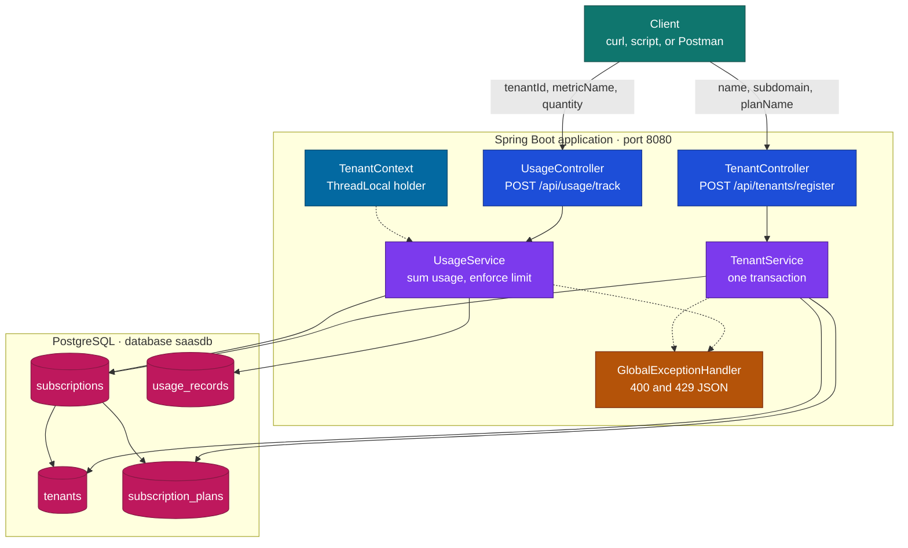
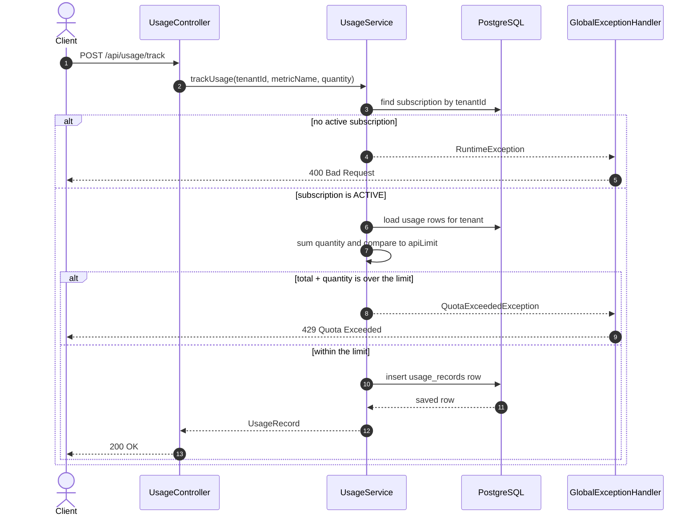
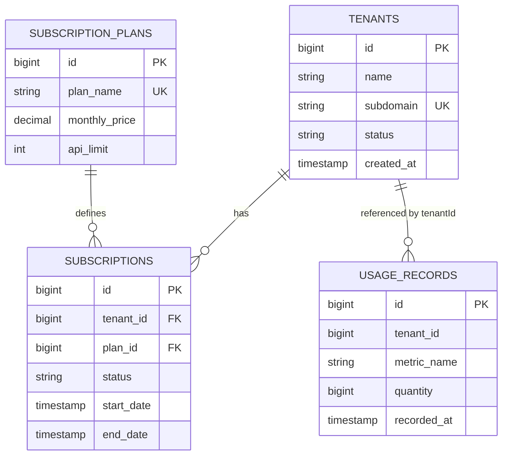

# Multi-Tenant SaaS Usage and Quota Service

A Spring Boot service that registers a customer as a tenant, attaches a subscription plan, and records API usage against that plan’s limit. When a tenant would go past the limit, the call is rejected with **HTTP 429**.

This is the metering core of a SaaS product: who the customer is, which plan they pay for, how much they have used, and when to stop them.

## Why this project exists

A SaaS product sells the same software to many customers. Each customer is a **tenant**. Tenants do not all pay for the same capacity. A smaller plan might allow 1,000 API calls. A larger plan allows more. If the platform never checks that number, every tenant can consume unlimited capacity and the plan on the invoice is meaningless.

This service is the place that decision lives.

- **Register** creates the tenant and an active subscription in one database transaction.
- **Track** adds a usage event only when the subscription is active and the new quantity still fits inside `apiLimit`.
- **Reject** returns 429 when the next event would pass the limit, and it does not write that event.

The two HTTP endpoints are the contract. Postman is a convenient way to call them while building. The behavior that matters is the quota rule in `UsageService`, not the tool used to send the request.

## What it does

### Register a tenant

`POST /api/tenants/register`

| Query parameter | Meaning |
|---|---|
| `name` | Display name of the customer |
| `subdomain` | Unique key for the tenant, for example `acme` |
| `planName` | Plan to attach, for example `PRO` |

`TenantService.registerTenant` runs in a single transaction:

1. Insert a row in `tenants` with status `ACTIVE`. `subdomain` is unique.
2. Load `subscription_plans` by `planName`. If that plan does not exist yet, create it with monthly price `29.99` and `apiLimit` `1000`.
3. Insert a row in `subscriptions` for that tenant and plan, status `ACTIVE`, starting now and ending one month later.

The response is the saved tenant: `id`, `name`, `subdomain`, `status`, `createdAt`. Later usage calls use that `id` as `tenantId`.

### Track usage

`POST /api/usage/track`

| Query parameter | Meaning |
|---|---|
| `tenantId` | Id returned by registration |
| `metricName` | What was consumed, for example `API_CALLS` |
| `quantity` | How many units this event adds |

`UsageService.trackUsage` runs in a single transaction:

1. Load the subscription for `tenantId`. No subscription, or a status other than `ACTIVE`, becomes HTTP 400.
2. Load that tenant’s usage rows and sum `quantity`.
3. If `totalUsed + quantity` is greater than the plan’s `apiLimit`, throw `QuotaExceededException`. Nothing is saved. The response is HTTP 429.
4. Otherwise insert one row in `usage_records` and return it.

Usage is cumulative for the tenant across every stored row. `subscriptions.endDate` is written at registration and is not read during the check.

### Errors

`GlobalExceptionHandler` turns failures into JSON:

| Situation | HTTP status | `error` field |
|---|---|---|
| Adding this quantity would pass `apiLimit` | 429 | `Quota Exceeded` |
| Any other `RuntimeException` (missing subscription, inactive subscription) | 400 | `Bad Request` |

A 429 body looks like:

```json
{
  "timestamp": "2026-10-27T11:00:00",
  "status": 429,
  "error": "Quota Exceeded",
  "message": "Quota exceeded! Plan limit is 1000. Current usage: 1000"
}
```

## Architecture

The browser, a script, or Postman calls the Spring MVC controllers. Controllers only forward parameters. Services own the rules and the transaction. Repositories talk to PostgreSQL through Spring Data JPA. Quota failures are mapped to HTTP by the exception handler.

`TenantContext` is a `ThreadLocal` for the tenant id of the current request, with a `clear()` method so a pooled thread cannot keep another tenant’s id. The endpoints in this version pass `tenantId` as a query parameter. No filter writes `TenantContext` yet.

Redis is on the classpath through the Spring AI Redis vector-store starter. Vector-store auto-configuration is turned off in `application.properties`. Quota checks use PostgreSQL, not Redis.



### Request path for a usage call



## Tech stack

| Piece | Version / choice |
|---|---|
| Java | 25 |
| Spring Boot | 4.1.2 |
| Web | `spring-boot-starter-webmvc` |
| Persistence | Spring Data JPA, Hibernate `ddl-auto=update` |
| Database | PostgreSQL (`saasdb` on `localhost:5432`) |
| Validation library | On the classpath; endpoints currently use query parameters |
| Boilerplate | Lombok |
| Build | Maven Wrapper (`mvnw`, `mvnw.cmd`) |

H2 is a test/runtime dependency. The running configuration points at PostgreSQL.

## Project layout

```text
src/main/java/com/example/demo
├── DemoApplication.java
├── context/TenantContext.java
├── controller
│   ├── TenantController.java
│   └── UsageController.java
├── service
│   ├── TenantService.java
│   └── UsageService.java
├── repository
│   ├── TenantRepository.java
│   ├── SubscriptionPlanRepository.java
│   ├── SubscriptionRepository.java
│   └── UsageRecordRepository.java
├── entity
│   ├── Tenant.java
│   ├── SubscriptionPlan.java
│   ├── Subscription.java
│   └── UsageRecord.java
└── exception
    ├── QuotaExceededException.java
    └── GlobalExceptionHandler.java
src/main/resources/application.properties
```

## Data model



| Table | What a row means |
|---|---|
| `tenants` | One customer. `subdomain` cannot repeat. Status starts as `ACTIVE`. `createdAt` is set on insert. |
| `subscription_plans` | A sellable plan: name, monthly price, and the numeric API allowance. |
| `subscriptions` | The plan assigned to one tenant, with status and a start/end window. |
| `usage_records` | One consumption event. `tenantId` is stored as a number. `recordedAt` is set on insert. |

Hibernate creates and updates these tables on startup because `spring.jpa.hibernate.ddl-auto=update`.

## Run it locally

### What you need

- JDK 25
- PostgreSQL listening on `localhost:5432`
- This repository

Maven does not have to be installed globally. Use `./mvnw` on Linux and macOS, or `mvnw.cmd` on Windows.

### 1. Create the database

In `psql`, as a user that can create databases:

```sql
CREATE DATABASE saasdb;
```

The app expects user `postgres` on port `5432`. Set that user’s password to the value of `spring.datasource.password` in `src/main/resources/application.properties`, or change the properties to match your local user and password.

Keep that password out of git history when this repository is published. Prefer environment-specific configuration over a shared password in the file.

### 2. Confirm the datasource

`src/main/resources/application.properties` is the file the app reads:

```properties
server.port=8080
spring.datasource.url=jdbc:postgresql://localhost:5432/saasdb
spring.datasource.username=postgres
spring.datasource.password=<your-local-password>
spring.jpa.hibernate.ddl-auto=update
```

Leave the Redis vector-store exclude line as it is. Quota storage is PostgreSQL.

### 3. Start the application

From the project root (`demo/`):

```bash
./mvnw spring-boot:run
```

On Windows:

```bat
mvnw.cmd spring-boot:run
```

Wait until the log shows the app listening on port **8080**. The first startup creates the four tables.

### 4. Register a tenant

```bash
curl -X POST "http://localhost:8080/api/tenants/register?name=Acme%20Inc&subdomain=acme&planName=PRO"
```

Example response:

```json
{
  "id": 1,
  "name": "Acme Inc",
  "subdomain": "acme",
  "status": "ACTIVE",
  "createdAt": "2026-10-27T11:05:00"
}
```

Use the returned `id` in the next call. Registering the same `subdomain` again fails because of the unique column.

The first time you use a `planName`, the service also inserts that plan at price `29.99` with limit `1000`. A later registration with the same `planName` reuses that plan.

### 5. Record usage under the limit

```bash
curl -X POST "http://localhost:8080/api/usage/track?tenantId=1&metricName=API_CALLS&quantity=10"
```

Example response:

```json
{
  "id": 1,
  "tenantId": 1,
  "metricName": "API_CALLS",
  "quantity": 10,
  "recordedAt": "2026-10-27T11:06:00"
}
```

### 6. Cross the limit and read the 429

With the default plan, the tenant can record quantities that sum to 1000. The next unit is rejected.

```bash
curl -i -X POST "http://localhost:8080/api/usage/track?tenantId=1&metricName=API_CALLS&quantity=1000"
curl -i -X POST "http://localhost:8080/api/usage/track?tenantId=1&metricName=API_CALLS&quantity=1"
```

The first call returns **200** when no earlier usage exists. The second returns **429** and does not add a row.

### 7. Call it with an unknown tenant

```bash
curl -i -X POST "http://localhost:8080/api/usage/track?tenantId=999&metricName=API_CALLS&quantity=1"
```

That returns **400** with the message that no subscription exists for that tenant.

## Tests

```bash
./mvnw test
```

`DemoApplicationTests` checks that the Spring context loads. The quota examples above are the behavioral check for this version.

## Configuration reference

| Property | Role |
|---|---|
| `server.port` | HTTP port, default `8080` |
| `spring.datasource.*` | PostgreSQL connection |
| `spring.jpa.hibernate.ddl-auto` | `update` so Hibernate aligns tables with the entities |
| `spring.jpa.show-sql` | Prints SQL while you are developing |
| `spring.autoconfigure.exclude` | Disables Redis vector-store auto-configuration |

## Scope of this version

Registration, plan assignment, usage recording, and the 429 quota response are implemented. The running path identifies the tenant with `tenantId` on the request. `TenantContext` is ready for a later filter that would resolve the tenant from the call itself.
